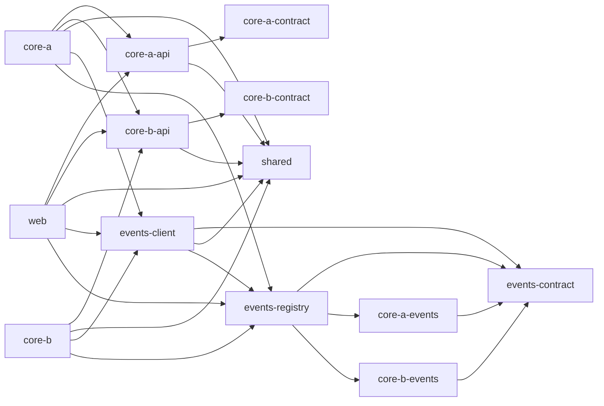

# Project Brief: Nx Monorepo with SvelteKit BFF + Two Core Backends

Use this document as the starting context to initialize the project. Service names (`core-a`, `core-b`) are placeholders; rename them to the real domains.

## 1. Goals and constraints

- **tRPC is mandatory** for all client-server and service-to-service communication that needs a typed request/response.
- **SvelteKit** is the frontend and also the BFF (backend-for-frontend). The browser only talks to SvelteKit.
- **Two core backend services** with no direct frontend access. They talk to each other and are called by SvelteKit. Services notify each other of business events through a shared typed events library with subscriptions defined in code and direct, instant tRPC calls (section 9). There is no event bus service.
- Everything lives in **one Nx monorepo**. Each app runs in its **own Docker container**.
- TypeScript everywhere.

## 2. Architecture

```
Browser ──tRPC──> SvelteKit (FE + BFF) ──tRPC/HTTP──> core-a
                                       ──tRPC/HTTP──> core-b
                  core-a ──tRPC/HTTP──> core-b   (and/or the reverse)

core-a, core-b ──> Postgres (each owns its own schema/database)
event owner (the only sender of that event type) ──tRPC events.deliver, instant and in parallel──> every subscribed service (core-a, core-b, web)
SvelteKit (BFF) ──> Redis (JWT token storage only)
```

- Browser to SvelteKit: tRPC router hosted inside SvelteKit (e.g. `trpc-sveltekit` or a custom handler in `hooks.server.ts` / `+server.ts`).
- SvelteKit to core services: server-side tRPC client only (in the tRPC context, `+page.server.ts`, `+server.ts`).
- Core to core: normal tRPC client over the Docker network (`http://core-b:3000/trpc`).
- Event notifications between services (typed business data such as currency rates and payment info, and typed notifications) are **not persisted, queued or retried**. Each event type has exactly one owning service, which defines its schema and is the only one allowed to send it. The owner calls every subscribed service **directly and instantly over tRPC** (`events.deliver`), using subscriptions defined in code (section 9). There is no event bus service, no BullMQ, and Redis is not used for messaging (Redis is used only for JWT token storage, section 7, point 3). tRPC is also used for calls that need an answer.
- **Real-time (subscriptions/WebSockets) exists only on the BFF.** Core services expose plain request/response tRPC over HTTP. When the browser needs live updates, core services publish typed events (section 9), the SvelteKit BFF is one of the subscribers (it receives the `events.deliver` calls), and forwards them to browsers through a tRPC subscription. SvelteKit with `adapter-node` has no built-in WebSocket support, so either use SSE-based tRPC subscriptions (no custom server needed) or add a custom server entry that attaches a `ws` server. Verify against current SvelteKit and tRPC docs when implementing.
- **End-user authentication happens only in SvelteKit** (session/login handled in `hooks.server.ts`). Core services never see credentials or sessions. The BFF propagates the authenticated end user's identity to core services on every call (see section 7, point 3), and core services use the JWT data as given, without verification, for authorization only (trusted network assumption, section 7, point 3).

## 3. Stack decisions

| Area | Choice |
|---|---|
| Monorepo | Nx with pnpm and a single root `package.json` (see 3.1) |
| Frontend + BFF | **SvelteKit 3** (required; see 3.1) |
| Core backends | Plain Node + tRPC (no NestJS) |
| HTTP layer | tRPC standalone adapter via `createHTTPHandler` inside `node:http` (see note on Fastify below) |
| DI | Awilix |
| Database | PostgreSQL + Drizzle ORM, configured once in the shared `shared/db` lib (query logging through the shared logger) |
| Migrations | `drizzle-kit generate` (commit SQL per service), applied as a separate step by the shared runner in `shared/migrations` |
| Redis | **BFF (`web`) only**, and only for JWT token storage (`ioredis`; see section 7, point 3). Core services have no Redis dependency. Not used for events, queues or caching. No BullMQ |
| Events | **No bus, no persistence, no retry.** One owning service per event type (defines the schema, only sender). Subscriptions defined in code; the owner calls every subscribed service instantly over tRPC (`events.deliver`) through a shared typed lib (see section 9) |
| Validation | Zod (shared schemas) |
| Logging | pino through the shared `shared/logging` lib (JSON in containers, `pino-pretty` in dev only) |
| Config | Zod-validated env at startup (fail fast) through the shared `shared/config` lib |
| Testing | Vitest + Testcontainers (real Postgres/Redis) |
| Lint / format | Shared ESLint flat config and Prettier config at the repo root; `apps/web` (SvelteKit) has its own ESLint and Prettier config (see 3.1) |
| Subscriptions | **BFF only** (SvelteKit app): tRPC subscriptions via SSE (`httpSubscriptionLink`) or `ws` + `applyWSSHandler` in a custom server entry. None on core services |

Note on Fastify: if the plain Node server becomes cramped (health checks, hooks, rate limiting, CORS), switch to tRPC's Fastify adapter. The routers do not change. Fastify is preferred over Express for tRPC. Register with `prefix: "/trpc"` and a high `maxParamLength` (e.g. 5000) for batched requests.

### 3.1 Tooling requirements

**SvelteKit 3 (mandatory)**
- SvelteKit 3 went stable on 1-2 October 2026. Start directly on v3; there is no v2 to migrate from.
- SvelteKit 3's minimum versions per the official migration guide (recheck at install time): Node 22.17, TypeScript 6, Svelte 5.57.1, Vite 8.0.12, `@sveltejs/vite-plugin-svelte` 7. These are only floors. The repo runs on Node 24 and the latest versions (section 3.2). Because the whole repo shares one set of dependency versions, the core services, Docker base images and CI also run on Node 24 and TypeScript 6.
- `svelte.config.js` is no longer supported. SvelteKit config is passed to the `sveltekit({...})` Vite plugin in `vite.config.ts`.
- The web app's `tsconfig.json` extends `$app/tsconfig` (not `./.svelte-kit/tsconfig.json`).
- `$lib` is replaced by `#lib`, which uses Node subpath imports (the `imports` field of `package.json`). **Conflict with the single root `package.json`**: the mapping must live in the root file, for example `"imports": { "#lib/*": "./apps/web/src/lib/*" }`. This is acceptable while `web` is the only SvelteKit app, but it is a global mapping. Verify early that SvelteKit, Vite, TypeScript and ESLint all resolve `#lib` correctly in this layout (setup task 2). If it does not work cleanly, the fallback is a `package.json` inside `apps/web` used only for `imports`, which would be a deliberate exception to the single-package rule.
- Remote functions are still experimental in v3. They are not used; tRPC remains the client-server layer.

**pnpm with one `package.json`**
- pnpm is the package manager. There is exactly one `package.json` and one `pnpm-lock.yaml`, both in the monorepo root. No per-project `package.json` files and no pnpm workspaces. All dependencies (runtime and dev) are declared in the root file, which gives a single version policy.
- Workspace libs are linked through path mappings in `tsconfig.base.json`, not through package names or the `workspace:` protocol.
- Pin `packageManager` (pnpm version) and `engines.node` (`>=24 <25`) in the root `package.json`, add a `.node-version` file with `24`, and use Corepack.
- Scaffolders (`sv create`, Nx generators) may create a `package.json` in the project folder. Merge its dependencies into the root file and delete it.
- Docker images must contain only what the app needs. Bundle the apps (esbuild or Vite) so workspace libs are inlined. For dependencies that stay external at runtime (for example the SvelteKit adapter-node output, native modules), either generate a pruned `package.json` per app from the Nx graph at build time (for example the esbuild executor's `generatePackageJson` option) or install production dependencies from the root lockfile. The first gives smaller images. Decide in setup task 16 and verify against the current Nx docs.

**Lint and Prettier rules (root config, with `apps/web` as the exception)**
- Root: one ESLint flat config (`eslint.config.mjs`) and one Prettier config (`.prettierrc`, `.prettierignore`) for the core services and all libs: typescript-eslint, Node settings, `@nx/enforce-module-boundaries` and the import restrictions from sections 8.2 and 8.7. Per-project config files, if any, only extend the root config.
- **Exception: `apps/web` (SvelteKit) has its own ESLint config (`apps/web/eslint.config.mjs`) and its own Prettier config (`apps/web/.prettierrc`)**, with the Svelte-specific plugins and rules (`eslint-plugin-svelte`, `prettier-plugin-svelte`) and any style choices that differ from the root. It does not have to extend the root rules. It still uses the root pnpm setup: no `package.json` in `apps/web`, and all dependencies, including its lint and Prettier plugins, are declared in the root `package.json`. The ESLint and Prettier versions are shared (single version policy); only the configuration differs.
- The web ESLint config must still include `@nx/enforce-module-boundaries` and the import restrictions from sections 8.2 and 8.7, otherwise `web` escapes the module boundaries. Keep them in one small shared module (for example `tools/eslint/boundaries.mjs`) that both the root config and the web config import.
- Prettier uses the nearest config file for each file, so `apps/web/.prettierrc` applies to web files and the root config to everything else. ESLint runs per project through the Nx `lint` target, which picks up the project's own config. Verify both with `nx format:check` and `nx lint web` during setup.
- Shared strict TypeScript settings in `tsconfig.base.json`.
- Add an `.editorconfig`. A pre-commit hook (husky + lint-staged) is optional.
- Enforced in CI via `nx format:check` and `nx affected -t lint` (section 8.8).

### 3.2 Version policy: Node 24, latest at the start, then locked

- **Node.js 24 everywhere**: local development (`.node-version`), CI, and Docker base images (`node:24`), with `engines.node` pinned to 24.x. Node 24 is the Active LTS line. Node 26 is newer but is not used. Nx 23 and SvelteKit 3 both support Node 24.
- **Start from the latest, then lock.** At project creation, resolve the latest stable version of every package and technology once, and write that exact version into the repo. The repo never uses `@latest`, `latest` or version ranges.
  - `.npmrc` has `save-exact=true`, so `package.json` holds exact versions (no `^` or `~`).
  - `pnpm-lock.yaml` is committed, and CI and Docker install with `pnpm install --frozen-lockfile`.
  - Exact pins also for `packageManager` (pnpm), Nx and its plugins (all on the same version), the `.node-version` file (the exact Node 24.x.y resolved at creation) and the Docker base image tag (`node:24.x.y`).
  - No pre-releases (alpha, beta, rc, next) unless a hard requirement says so.
  - Upgrades happen only deliberately, in a dedicated change: `pnpm up <package>` (for Nx, `nx migrate`), followed by the compatibility check below. An update bot (Renovate or Dependabot) opening grouped PRs is optional.
  - This brief lists no version numbers except hard floors, so it stays correct: the versions are whatever was latest on the day of setup and are then recorded by the lockfile.
- **Exceptions where "latest" is not usable** (record each one with its reason in a `docs/versions.md` file in the repo):
  - **TypeScript 6.x, not 7.** SvelteKit 3 requires TypeScript 6, and Nx 23.1 supports 6 but advises running TypeScript 7 only side by side, because TypeScript 7 does not yet ship a programmatic API that Nx relies on.
  - Anything else the compatibility check below turns up.
- **Compatibility check at setup, before any feature work:** install the full latest set, then run `pnpm install`, `nx graph` and `nx run-many -t typecheck lint test build` on the skeleton apps. Combinations to watch, which were not verified in advance: the latest pnpm major with Nx, the latest Vitest major with Vite 8 (required by SvelteKit 3), the ESLint major with `eslint-plugin-svelte`, `typescript-eslint` and Nx, the Zod major with tRPC, and `drizzle-orm`/`drizzle-kit` with the `pg` driver and the shared migration runner. If a combination fails, step down the least central package, never the frameworks, and record it in `docs/versions.md`.
- Reference points reported by release trackers at the time of writing (verify at install): Nx 23.x (23.1, July 2026: full TypeScript 6 support in the plugins, ESLint 9 flat config), tRPC 11.x (11.21.0 in late September 2026), pnpm 12.x, Vitest 5.

## 4. Nx workspace layout

```
apps/
  web/                  # SvelteKit (FE + BFF)
  core-a/               # service: composition root, server, context, routers, db, migrations
  core-b/               # service: same structure
libs/
  core-a-contract/      # leaf: Zod schemas, DTO types, error codes, service "port" interfaces
  core-a-api/           # tRPC router definition (thin, delegates to ports via context) + AppRouter type
  core-b-contract/      # same for core-b
  core-b-api/           # same for core-b
  shared/
    config/             # Zod env loading (fail fast), common base env schema, secret redaction
    logging/            # pino factory (dev pretty / container JSON), redaction, service fields, request-ID child logger
    trpc/               # shared tRPC helpers (error mapping, JWT-decoding identity middleware, client factory)
    errors/             # domain error types
    db/                 # configured Drizzle + pg pool factory (query logging through the shared logger, ping, close, transaction helper); no schemas
    migrations/         # migration runner (advisory lock, logging) and drizzle-kit config helper; no migration files
  events-contract/      # defineEvent helper, envelope, ServiceId, generic events.deliver router type (leaf, non-buildable)
  core-a-events/        # schemas of the events core-a owns and sends (one lib per owning service)
  core-b-events/        # same for core-b
  events-registry/      # EVENTS map: event type -> owner + subscribers; derived types (EventsOwnedBy, EventsFor)
  events-client/        # createPublisher (owner-only, typed), createEventsRouter (subscriber side), instant parallel tRPC calls with timeout
```

### Library rules

- **Non-buildable (source-consumed) libs by default.** Make a lib buildable only if typechecking or build time actually hurts.
- `*-contract` libs hold runtime-safe, small shared code: Zod schemas, DTO types, error codes.
- The `AppRouter` type lives in `core-x-api`, which is **contract-first** (see section 8). It must never import from a service app, otherwise Nx sees a cycle (lib → app → lib). Consumers use `import type { AppRouter }` only. If typechecking gets slow, make `core-x-api` a declaration-only buildable project (`tsc --emitDeclarationOnly`, TS project references).
- Callers never import another service's internals.
- Use Nx tags and `@nx/enforce-module-boundaries`: apps may depend on `*-api`, `*-contract` and `shared/*` libs, never on another app or on a service's internals.
- Each service owns its Drizzle schema and its migration files inside its own app folder (not in a shared lib). The shared libs `shared/db` and `shared/migrations` contain only the common logic (section 5.1).

## 5. Per-service structure (core-a / core-b)

```
apps/core-a/
  src/
    main.ts             # composition root: build Awilix root container, start server, graceful shutdown
    server.ts           # node:http server + createHTTPHandler, /healthz, /readyz
    config.ts           # Zod-validated env
    container.ts        # Awilix registrations (singletons: db pool, logger, other service clients, events client)
    trpc/
      context.ts        # createContext: scoped Awilix container per request, request-ID, child logger, caller identity
      trpc.ts           # initTRPC, base procedure, middlewares (auth, logging, error mapping)
      routers/          # procedures grouped by domain, merged into appRouter
    services/           # plain business logic classes/functions called by routers
    db/
      schema/           # Drizzle schema (owned by this service)
      migrations/       # generated SQL, committed
      drizzle.config.ts
    jobs/               # in-process background loops, if needed
    events/             # typed handlers for subscribed events, mounted via createEventsRouter (section 9)
  Dockerfile
  project.json
```

### Conventions

- **Awilix**: root container at startup, scoped container per request created in `createContext`. Services must not import the container; resolve only in the composition root and context. Register disposers (pg pool) and call `container.dispose()` on shutdown.
- **Graceful shutdown**: handle `SIGTERM`, stop accepting connections, drain, then close the pg pool.
- **Health**: `/healthz` (liveness) and `/readyz` (checks Postgres).
- **Errors**: map domain errors to `TRPCError` in one place (error middleware). Never throw raw errors across the service boundary.
- **Logging**: one pino child logger per request carrying a request ID. Forward the request ID as a header on service-to-service calls and read it in the callee's context.
- **Service-to-service client** (in the caller):

```ts
import { createTRPCClient, httpBatchLink } from "@trpc/client";
import type { AppRouter } from "@myorg/core-b-api"; // type-only entry point

export const coreB = createTRPCClient<AppRouter>({
  links: [
    httpBatchLink({
      url: process.env.CORE_B_URL!, // e.g. http://core-b:3000/trpc
      headers: () => ({
        authorization: `Bearer ${currentUserJwt()}`, // the end user's JWT (ctx.jwt), forwarded as is, only when the call needs the user's identity
        "x-service-id": process.env.SERVICE_ID!,
        "x-request-id": currentRequestId(),
      }),
      // add a custom fetch with timeout (and retries where safe)
    }),
  ],
});
```

### 5.1 Common BE helpers (`libs/shared`)

All core services (and `web` where it applies) use the same helpers from the common lib folder instead of each service re-implementing them. All are non-buildable libs tagged `type:shared`, `scope:shared`.

| Lib | Contains | Used by |
|---|---|---|
| `shared/config` | `loadConfig(schema)`: Zod parsing of env at startup, fail fast with readable errors, secret redaction when the config is logged. A common base schema (`NODE_ENV`, `SERVICE_ID`, `PORT`, `LOG_LEVEL`, `DATABASE_URL`, optional `DB_SCHEMA`, pool size, timeouts, subscriber URLs) that each service extends with its own variables | all apps |
| `shared/logging` | pino factory (pretty in dev, JSON in containers), common fields (service id, version), redaction paths, request-ID child logger helper | all apps, `shared/db`, `shared/migrations` |
| `shared/db` | `createDb(config, logger)` returning `{ db, pool, ping, close }`: a `pg` Pool with a deliberate size, Drizzle configured with a logger adapter that writes queries to the shared pino logger (debug level, parameters redacted by default, slow-query warning above a threshold), optional schema (search_path), a `withTransaction` helper, a readiness ping for `/readyz`, and a graceful close for shutdown. No schemas | core services |
| `shared/migrations` | `runMigrations({ pool, migrationsFolder, logger })`: takes a Postgres advisory lock, runs the Drizzle migrator, logs each applied migration, releases the lock. A standard `migrate` entry point that each service exposes as an Nx target, and `defineDrizzleConfig({ schema, out })` so each service's `drizzle.config.ts` is one line. No migration files | core services |

Rules:
- Each service keeps its own Drizzle schema, migration files and `drizzle.config.ts` in its own app folder. The shared libs hold logic only.
- Dependencies between shared libs: `shared/config` and `shared/logging` are leaves; `shared/db` depends on both; `shared/migrations` depends on `shared/db` and `shared/logging`.
- A service's `config.ts` only extends the base schema with its own variables.
- The same logging lib gives the same format and fields in every service, which the request-ID correlation (section 7) relies on.
- New common backend helpers go into `libs/shared/*`, not into a service.

## 6. Data and infrastructure rules

- **Postgres**: each service owns its schema or database. No service reads another service's tables; cross-service data access goes through tRPC. Whether that means a separate database or a separate schema on a shared instance is a deployment configuration (per-service `DATABASE_URL` and an optional schema name in the Zod-validated env), not a code decision. One `pg` Pool per service, created by the shared `shared/db` factory (section 5.1) with a deliberately set pool size, since services share one Postgres instance.
- **Migrations**: run as a separate deploy step or one-off container, not on every service start. If run at startup, take a Postgres advisory lock first to avoid races between replicas. The migration runner is shared (`shared/migrations`, section 5.1), so the advisory lock and logging behave the same in every service. How migrations are triggered in a runtime environment is out of scope; the image only needs to support running the migration command.
- **Redis is used by the BFF only, and only for JWT token storage** (`ioredis`, key prefix such as `jwt:`). Core services have no Redis dependency. Never for messaging, queues or the event bus. No BullMQ. Event notifications use direct tRPC calls between services (section 9).
- **Docker**: one image per app, built from the same repo. `web` (the BFF) runs as a single instance (section 9.6). Use `nx affected` for build/test/deploy.

## 7. Cross-cutting concerns and caveats

1. **Type safety is compile-time only.** Services deploy independently, so callers and callees can briefly be out of sync. Make API changes additive or deploy affected services together.
2. **tRPC is synchronous request/response.** For one-to-many notifications use the in-code event subscriptions (section 9); they are instant, best-effort calls with no persistence and no retry.
3. **Auth and identity propagation.** End users are authenticated in SvelteKit only, and their identity is propagated to the core services. **Decision: core services use the JWT data without verification.** They decode the token and use its claims as given. There is no signature, `aud` or `exp` check, no signing key or JWKS in core service config, and no revocation check.
   - **Trust condition:** this is safe only while the core services are reachable exclusively from the BFF and other internal services (private Docker network, no public port, no direct browser access). Anyone who can call a core service directly can claim any identity and any roles.
   - The JWT travels in a request header (`authorization: Bearer <jwt>`). The BFF sets it on every call to a core service. Core services decode it in a tRPC middleware, keep the raw header value in the context (`ctx.jwt`) and the decoded claims as `ctx.identity`, and make **authorization** decisions (permissions, ownership) from it. They do no end-user authentication of their own.
   - A core service that calls another service **forwards the header only when it needs the user's identity there**: it passes `ctx.jwt` to the shared tRPC client factory (`shared/trpc`) for that call, and omits it for service-only calls. Callers also send their own service id in the `x-service-id` header; it is informational and not verified. Events do not carry the JWT.
   - **Redis is used by the BFF only** (JWT token storage; key prefix `jwt:`, TTL matching the token lifetime). Core services have no Redis client, dependency or config and never read Redis. They only receive the JWT in the header.
   - If the trust condition ever changes (for example a core service becomes reachable from outside), add verification (signature, `aud`, `exp`) in the same tRPC middleware. No other code depends on it.
4. **Not a public API.** If an external consumer ever needs a core service, add a REST/OpenAPI layer on top.
5. **Timeouts and resilience.** `httpBatchLink` has no retry or circuit breaker by default; add timeouts via a custom `fetch`.
6. **Observability.** Request-ID correlation now; OpenTelemetry tracing later.

## 8. Type linking, dependency graph and `nx affected`

### 8.1 Correction to the earlier type approach

Exporting `typeof appRouter` from the service app and re-exporting it through a lib makes the lib depend on the app. Nx counts `import type` as a dependency, so that creates a lib → app → lib cycle, and with services calling each other it becomes an app ↔ app cycle. It also means any internal change in a service (services, db, migrations) invalidates typechecking in every caller. Therefore the router definition moves into a **contract-first `*-api` lib** that never imports from an app.

### 8.2 Contract-first split (per service `core-x`)

- `core-x-contract` (leaf): Zod schemas, DTO types, error codes, and **port interfaces** (e.g. `InvoicesService`) that the router needs.
- `core-x-api`: the `CoreXContext` interface (ports + logger + caller identity), a thin tRPC router that validates input with the contract schemas and delegates to `ctx` ports, and `export type AppRouter = typeof appRouter`. Depends only on its contract lib and `shared/*`, never on an app.
- `apps/core-x`: implements the ports (services, Drizzle), builds the context in `createContext`, and mounts the router.
- **Two entry points per api lib**, so consumers cannot import runtime code by accident:
  - `@myorg/core-x-api` exports types only (`AppRouter`, contract re-exports). Used by `web` and by other services.
  - `@myorg/core-x-api/server` exports `appRouter` and `CoreXContext`. Used only by `apps/core-x`.
  - Both are path mappings in `tsconfig.base.json`. Enforce with ESLint `no-restricted-imports` (forbid `@myorg/*-api/server` outside the owning app, and require `import type` for `@myorg/*-api` in other apps, e.g. with `@typescript-eslint/consistent-type-imports`).

```ts
// libs/core-b-api/src/server.ts
import { initTRPC } from "@trpc/server";
import { createInvoiceInput, type InvoicesService } from "@myorg/core-b-contract";

export interface CoreBContext {
  services: { invoices: InvoicesService }; // implemented in apps/core-b
  log: Logger;
  requestId: string;
}

const t = initTRPC.context<CoreBContext>().create();

export const appRouter = t.router({
  invoices: t.router({
    create: t.procedure
      .input(createInvoiceInput)
      .mutation(({ input, ctx }) => ctx.services.invoices.create(input)),
  }),
});

export type AppRouter = typeof appRouter;
```

```ts
// libs/core-b-api/src/index.ts  (consumer entry, types only)
export type { AppRouter } from "./server";
export * from "@myorg/core-b-contract"; // schemas/types consumers may need
```

Trade-off: slightly more boilerplate (ports and a context interface) in exchange for an acyclic graph and precise `affected` results. Business logic stays in the app.

### 8.3 Dependency graph

Assumed call directions: `web` calls core-a and core-b; core-a calls core-b. A reverse call (core-b → core-a) would **not** create a cycle, because apps depend only on `*-api` libs and `*-api` libs never depend on apps. Check the real graph with `nx graph`.



### 8.4 What `nx affected` builds

Because callers depend on `*-api` and not on service apps, internal service changes do not ripple outward.

| Changed project | Affected (lint / typecheck / test) | Affected apps (build, docker image) |
|---|---|---|
| `core-a-contract` | core-a-api, core-a, web | core-a, web |
| `core-a-api` (router shape) | core-a, web | core-a, web |
| `core-a` internals (services, db, migrations) | core-a | core-a only |
| `core-b-contract` | core-b-api, core-b, core-a, web | core-b, core-a, web |
| `core-b-api` (router shape) | core-b, core-a, web | core-b, core-a, web |
| `core-b` internals | core-b | core-b only |
| `events-contract` | core-a-events, core-b-events, events-registry, events-client, core-a, core-b, web | core-a, core-b, web |
| `events-client` | core-a, core-b, web | core-a, core-b, web |
| `core-a-events`, `core-b-events`, `events-registry` (event schemas, subscriptions) | events-registry, events-client, core-a, core-b, web | core-a, core-b, web |
| `shared/*` | all projects | all apps |
| `web` | web | web only |

Notes:
- Libs are non-buildable, so `build` runs only for apps. `lint`, `typecheck` and `test` also run on affected libs.
- Rows change if call directions change (for example core-b → core-a adds core-a-api consumers).
- Any change to an event schema or to the registry rebuilds every app that uses events (they all depend on `events-registry`). If that blast radius becomes a problem, split the registry per domain (payments, currency, notifications).

### 8.5 Commands

```bash
nx graph                                              # explore the full project graph
nx show projects --affected --base=origin/main        # list affected projects
nx affected -t build --base=origin/main --graph       # visualize what would build
nx affected -t lint typecheck test build --base=origin/main --head=HEAD
nx affected -t docker-build --base=origin/main        # images for affected apps only
```

(Verify exact flags against the Nx version you install.)

### 8.6 `nx.json` baseline

```json
{
  "namedInputs": {
    "default": ["{projectRoot}/**/*", "sharedGlobals"],
    "production": [
      "default",
      "!{projectRoot}/**/*.spec.ts",
      "!{projectRoot}/**/*.test.ts"
    ],
    "sharedGlobals": []
  },
  "targetDefaults": {
    "build":        { "dependsOn": ["^build"], "inputs": ["production", "^production"], "cache": true },
    "typecheck":    { "dependsOn": ["^typecheck"], "cache": true },
    "lint":         { "cache": true },
    "test":         { "inputs": ["default", "^production"], "cache": true },
    "docker-build": { "dependsOn": ["build"] }
  }
}
```

Each app gets a `docker-build` target (builds an image from the app's bundled output). Prefer bundling apps with esbuild so workspace libs are inlined into the image.

### 8.7 Tags and boundary rules

Tags:
- `type:app`, `type:api`, `type:contract`, `type:shared`
- `scope:web`, `scope:core-a`, `scope:core-b`, `scope:shared`

`@nx/enforce-module-boundaries` constraints:
- `type:app` may depend on `type:api`, `type:contract`, `type:shared`
- `type:api` may depend on `type:contract`, `type:shared`
- `type:contract` may depend on `type:contract` (own scope), `type:shared`
- `type:shared` may depend on `type:shared`, with one exception: `events-client` (`type:shared`, `scope:shared`) may depend on `events-registry` and `events-contract` (both `type:contract`, `scope:shared`)
- `events-registry` (`type:contract`, `scope:shared`) is the one contract lib allowed to depend on other scopes' `type:contract` libs (`core-a-events`, `core-b-events`)
- An app may use another scope's `type:api` lib only through the types-only entry point (ESLint rule above)
- Nothing depends on a `type:app`

### 8.8 CI flow (GitHub Actions, ends at Docker build)

1. Set base/head SHAs (`nrwl/nx-set-shas` in GitHub Actions).
2. `nx format:check` and `nx affected -t lint typecheck test`
3. `nx affected -t build`
4. `nx affected -t docker-build`, then push images only for affected apps.

Scope: the Docker image build and push in GitHub is the last part of this project. Deployment and Kubernetes are out of scope. Keep API changes additive where possible, because the runtime rollout order of services is not handled here.

## 9. Event notifications (in-code subscriptions, direct tRPC calls)

### 9.1 Decision

- **No event bus service, no middle layer, no persistence, no retry, no queue.** Redis and BullMQ are not involved (Redis is only used for JWT token storage, section 7, point 3).
- The mechanism is only two things: **subscriptions defined in code**, and an **instant, typed tRPC call from the owning service to every subscribed service**.
- **Ownership:** each event type has exactly one owning service. The owner defines the event's schema and is the only service allowed to send it. Every other service can only subscribe, and it must use the owner's schema. An owner does not subscribe to its own event types, so there is no in-process delivery path.
- It covers typed business data (currency rates, payment info) and typed notifications.
- Flow:
  1. The owning service finishes and commits its own database change.
  2. It calls `publish(event)` from its publisher (`createPublisher`, section 9.5).
  3. The lib validates the event with Zod and looks up the subscribers in the registry.
  4. It calls every subscriber's `events.deliver` immediately and in parallel over tRPC, each call with a short timeout.
  5. Each subscriber checks that the sender is the registered owner, validates the envelope and runs its typed handler.
  6. `publish` returns the per-subscriber result (delivered or failed) to the caller, which logs it. Failed deliveries are not retried.

### 9.2 Guarantees (explicit trade-off)

- **Best effort, at most once.** A subscriber that is down, too slow or returns an error misses that event for good. This is accepted by design: an event is just an event and may be missed.
- **Order is not important and is not guaranteed.** Calls run concurrently and may arrive in any order. Subscribers must not depend on arrival order (for example, a handler that needs the latest value compares `occurredAt` or reads current state through a tRPC query).
- **Events are signals, not the source of truth.** The owning service's own database is. A subscriber that wants correct state can read it through an ordinary tRPC query (for example latest currency rate, payment status); nothing in the event mechanism requires it.
- **Anything that must not be lost is not modeled as an event** (for example moving money). It uses a direct tRPC call whose result the caller checks, and the caller decides what to do on failure (retry in its own code or fail the request).
- **Publish after the database commit**, never before, so subscribers are not told about changes that were rolled back.
- If guaranteed delivery is needed later, the `publish()` API and the `events.deliver` contract can stay the same, with an outbox or a bus added behind them, so subscribers would not change.

### 9.3 Ownership, schemas and subscriptions in code

- Each owning service defines the events it sends in its own lib, `core-x-events`, using `defineEvent` from `events-contract`. The lib folder is owned by that service (CODEOWNERS). Subscribers receive the schemas through the registry.
- `events-registry` assembles everything in one typed map. It is the single source of truth for who owns an event and who subscribes. Owner and subscriber names below are placeholders until they are assigned.

```ts
// libs/events-registry/src/index.ts
import { currencyRateUpdated } from "@myorg/core-a-events";
import { paymentStatusChanged } from "@myorg/core-b-events";

export const EVENTS = {
  "currency.rate.updated":  { owner: "core-a", schema: currencyRateUpdated,  subscribers: ["core-b", "web"] },
  "payment.status.changed": { owner: "core-b", schema: paymentStatusChanged, subscribers: ["core-a", "web"] },
} as const satisfies Record<string, EventDef>;
```

- Derived types: `EventType`, `EventsOwnedBy<S>` (the event types a service owns and may send), `EventsFor<S>` (the event types a service subscribes to). A type check (or unit test) ensures an owner never appears in its own subscriber list.
- **Receivers must use the sender's schema.** A subscriber never defines or copies its own version of an event's schema. Handler payload types come from the registry (the owner's `core-x-events` schema), and `events.deliver` validates every incoming event against that schema before the handler runs. An event that fails validation is rejected and not passed to the handler.
- Envelope on every event: `id` (UUID, for tracing or optional dedupe by a subscriber), `type`, `version`, `occurredAt`, `requestId`, `payload`. The schema is a Zod discriminated union on `type`. Compatibility rules: the owner changes its schema additively, subscribers ignore unknown fields, a breaking change means a new `type` or `version` handled in parallel during the transition. In the monorepo the compiler and `nx affected` show which subscribers are impacted.
- Each subscriber declares typed handlers with `createEventsRouter(serviceId, handlers)`. The handler map type is derived from the registry (`EventsFor<"core-a">`), so a service has handlers for exactly the event types it subscribes to, and the compiler enforces it.

### 9.4 Typed communication over tRPC

- `events-contract` exports a generic `EventsRouter` type with one procedure, `events.deliver` (input: the event union, output: acknowledgement). The owner's tRPC clients are built from this type, so the owner depends on no subscriber's `*-api` lib or app, and the Nx graph gets no cycles.
- Each subscriber mounts `createEventsRouter(...)` on its own HTTP path (for example `/events`), separate from its domain tRPC router. The domain `AppRouter` types are unaffected.
- Subscriber URLs come from the same Zod-validated env config as the service-to-service clients (for example `CORE_A_URL`, `CORE_B_URL`, `WEB_URL`).
- **Only the owner can send** (compile-time guarantee, plus a runtime consistency check):
  - Compile time: the publisher created with `createPublisher("core-a")` accepts only event types in `EventsOwnedBy<"core-a">`. Sending another service's event is a compile error.
  - Runtime: the publisher sends its service id in the `x-service-id` header, and `events.deliver` checks that it equals `EVENTS[type].owner` and rejects other values. Because service identity is not verified (section 7, point 3), this is a consistency check against bugs and misconfiguration, not a security control.

### 9.5 `events-client` behavior

- `createPublisher(serviceId)` returns `publish(event, opts?)`: validate, fill `id`, `occurredAt` and `requestId` (from the request context), look up the subscribers, start all calls at once (`Promise.allSettled`) each with a short timeout (for example 2-3 s, configurable), no retry and no queue. Failures are logged with event type, subscriber and request ID. It returns `{ delivered: ServiceId[], failed: { subscriber: ServiceId, error: string }[] }`.
- Two usage modes: awaited (the default; the caller sees the results) or detached (`void publish(...)`; non-critical notifications must not slow down the request).
- Subscribers are independent: a slow or failing one does not affect the others.
- Handlers may send their own service's events. Avoid event cycles (A sends to B, B's handler sends back to A).
- Registered as an Awilix singleton. One tRPC client per target service is created once and reused (keep-alive).

### 9.6 BFF and browser notifications

- `web` is a normal subscriber (it owns no events). Its `events.deliver` handler forwards the events to the browsers connected to that instance through the tRPC subscription (SSE) from section 2.
- **Constraint (decided):** the BFF (`web`) runs as **exactly one instance**. An `events.deliver` call reaches one instance, so with several instances a browser connected to another one would miss the notification. Do not scale `web` horizontally. If that ever changes, the options are fan-out by the owner to every BFF instance address, or sticky routing by user.
- Notifications that an offline user must not miss are stored in Postgres by the owning core service as part of its own domain (for example `customerService`), with a tRPC query to fetch missed ones on reconnect. That is domain data, not part of the event mechanism.

### 9.7 Observability and Nx

- Log every publish (event id, type, per-subscriber result, duration) with the request ID. Counters for failed deliveries per event type and subscriber.
- Libs, all non-buildable:
  - `events-contract` (`type:contract`, `scope:shared`): `defineEvent`, envelope, `ServiceId`, generic router type.
  - `core-x-events` (`type:contract`, `scope:core-x`): the event schemas that service owns.
  - `events-registry` (`type:contract`, `scope:shared`): the `EVENTS` map and derived types; may depend on every `core-x-events` lib.
  - `events-client` (`type:shared`, `scope:shared`): `createPublisher`, `createEventsRouter`.
- There is no `*-api` lib and no extra service for events. The graph, affected table and tag rules are in sections 8.3, 8.4 and 8.7. A change to an event schema or to the registry affects every app that uses events.
- Tests: setup tasks 17-19.

## 10. Initial setup tasks for Claude Code

1. Create the Nx workspace with pnpm, a **single root `package.json`** (no per-project `package.json`, no workspaces) and TS path mappings in `tsconfig.base.json`. Pin `packageManager` and `engines.node` (Node 24, see section 3.2), add `.node-version`, and add `.npmrc` with `save-exact=true`. Resolve the latest stable versions once, then keep them as exact pins. Check the current Nx docs for how to set this up (for example `nx init` or a `create-nx-workspace` preset).
2. Generate apps: `web` (**SvelteKit 3**, scaffolded for example with `npx sv create`, then its dependencies merged into the root `package.json` and the scaffolded `package.json` removed), `core-a`, `core-b` (plain Node). SvelteKit config goes in `vite.config.ts`, tsconfig extends `$app/tsconfig`, and `#lib` is mapped through the root `imports` field. Verify that `#lib` resolves in dev, build, typecheck and lint before continuing (see section 3.1).
3. Generate libs: `core-a-contract`, `core-a-api`, `core-b-contract`, `core-b-api`, `shared/config`, `shared/logging`, `shared/db`, `shared/migrations`, `shared/trpc`, `shared/errors`. Add the two entry-point path mappings per api lib (types-only and `/server`).
4. Configure `@nx/enforce-module-boundaries` with the tags and constraints from section 8.7, plus ESLint rules restricting `@myorg/*-api/server` to the owning app and requiring `import type` for cross-service api imports.
5. Implement `shared/config` and `shared/logging` (section 5.1), then a minimal `core-a` and `core-b` on top of them: config (extending the base schema), Awilix container, shared pino logger, tRPC context and router with one example procedure each, `/healthz` and `/readyz` (using the `shared/db` ping once it exists), graceful shutdown.
6. Implement `shared/db` and `shared/migrations` (section 5.1), then add per service the Drizzle schema, an initial migration and a one-line `drizzle.config.ts`; wire the `migrate` Nx target as a separate command or container.
7. Reserve a separate HTTP path (for example `/events`) on each service's server where `events.deliver` will be mounted (implemented in steps 17-18). There is no event bus service and no queue infrastructure.
8. Wire the service-to-service tRPC clients (SvelteKit to core-a/core-b, core-a to core-b) with the end-user JWT in the `authorization` header (section 7, point 3), the `x-service-id` header, the request-ID header, and timeouts. Add a tRPC middleware that decodes the JWT (no verification) and fills `ctx.jwt` (raw header) and `ctx.identity` in both core services; the shared client factory forwards `ctx.jwt` only when a call passes it. In the BFF auth layer only, store the JWT tokens in Redis (`ioredis`) with a TTL matching the token lifetime. Core services get no Redis dependency.
9. Host the tRPC router inside SvelteKit for the browser, including one example subscription fed by an event that a core service delivers to `web` through `events.deliver`.
10. Write Dockerfiles per app (base image `node:24`) and a `docker-compose.yml` for local dev (Postgres, Redis for the BFF's JWT storage, all apps).
11. Set up Vitest and one Testcontainers-based integration test per service.
12. Apply the `nx.json` baseline from section 8.6 (named inputs, target defaults, caching) and add a `docker-build` target to each app.
13. Add a GitHub Actions workflow (Node 24) that runs the affected pipeline from section 8.8 and builds and pushes Docker images for affected apps only. This is the last step of the project; no deployment automation.
14. Verify with `nx graph` that the graph is acyclic and matches the table in section 8.4, then make a test change in `core-b` internals and confirm only `core-b` is affected.
15. Set up the ESLint flat config and Prettier config at the root as described in section 3.1, plus the separate ESLint and Prettier config in `apps/web`, with the boundary rules shared through one module, and `nx format:check` and `lint` targets (in practice, do this right after step 2 and before generating the libs).
16. Decide the Docker dependency strategy for the single `package.json` (pruned per-app `package.json` generated from the Nx graph, or production install from the root lockfile) and implement it in each app's `docker-build` target.
17. Create `events-contract` (`defineEvent` helper, envelope, `ServiceId`, generic `events.deliver` router type), one `core-x-events` lib per owning service (Zod schemas of the events that service owns), `events-registry` (the `EVENTS` map: event type to owner and subscribers, with derived types `EventType`, `EventsOwnedBy<S>`, `EventsFor<S>`, and a type check that an owner is never in its own subscriber list) and `events-client` (`createPublisher(serviceId)` whose `publish` accepts only event types owned by that service and calls every subscriber's `events.deliver` immediately and in parallel with a short timeout; `createEventsRouter(serviceId, handlers)` for the subscriber side, typed so that handlers exist exactly for the event types the service subscribes to). Subscriber URLs come from the Zod-validated env config. Add CODEOWNERS entries so each `core-x-events` lib is owned by its service.
18. Mount `events.deliver` on each subscribing service (core-a, core-b, web) on its own path, and register the handlers. The handler checks that the `x-service-id` header equals the registered owner of the event type and rejects other values (a consistency check, not a security control). For `web`, the handler forwards the events to connected browsers through a tRPC subscription.
19. Add tests: Vitest unit tests for `publish` (validation, parallel calls, timeout, one failing subscriber does not affect the others, results returned to the caller), a type test that a service cannot publish an event it does not own, a runtime test that `events.deliver` rejects a sender that is not the owner, and an integration test with real subscriber servers verifying typed end-to-end delivery. Add logs and counters for failed deliveries (event type, subscriber, request ID).

## 11. Open questions

- Real names and domains of `core-a` and `core-b`, and which calls go in which direction between them. Example services named so far (not yet assigned to `core-a`/`core-b`): `emailSender`, `documentGenerator`, `customerService`. The brief plans two core services, so decide which two to start with, or whether the workspace starts with all three (the Nx layout, `*-api`/`*-contract` split and affected table in section 8.4 extend the same way to a third service).
- Event assignment: the ownership and schema rules are decided (section 9.3): one owning service per event type, the sender defines the schema, the only sender is the owner, and receivers must use that schema. Still to decide: which service owns currency rates, payment events and notifications, and which services subscribe to each.
